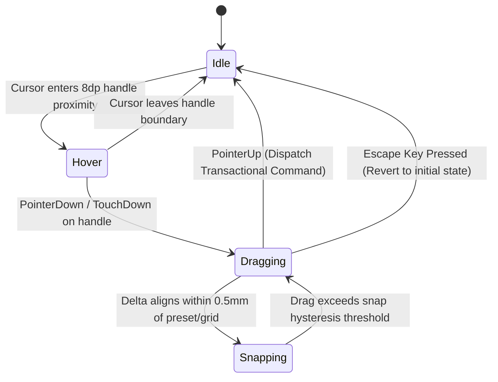

# Plain Platform Integration & Development Master Blueprint
## Transition from SarvMD to Plain Composer (v1.0 & Beyond)

> **Document Status:** Active Master Architecture & Migration Blueprint  
> **Author:** Pooria Askari Moqaddam  
> **Target Brand:** Plain Composer / Plain Platform  
> **Scope:** Repository Migration, Rebranding, pub.dev Engine Publishing, CAD Drag Engine, Notation Pipeline, Commercial Packaging

---

## Table of Contents
1. [Executive Vision & Dual-Track Strategy](#1-executive-vision--dual-track-strategy)
2. [Codebase Migration & Rebranding Playbook](#2-codebase-migration--rebranding-playbook)
3. [Decoupling & Publishing the Core Engine to pub.dev (`plain_score`)](#3-decoupling--publishing-the-core-engine-to-pubdev-plain_score)
4. [Deep Technical Specification: Interactive On-Canvas CAD Manipulation Engine](#4-deep-technical-specification-interactive-on-canvas-cad-manipulation-engine)
5. [Near-Term Engraving & Composition Essentials](#5-near-term-engraving--composition-essentials)
6. [Long-Term Horizon: Native Rational Notation Engine](#6-long-term-horizon-native-rational-notation-engine)
7. [Commercial Packaging, Licensing & Distribution Architecture](#7-commercial-packaging-licensing--distribution-architecture)
8. [Master Execution Checklist](#8-master-execution-checklist)

---

## 1. Executive Vision & Dual-Track Strategy

SarvMD reaches its final public milestone at **v0.13.0** as a battle-tested, mathematically rigorous "Blank Canvas" manuscript designer (399 automated tests, zero-dependency Dart core, Gouldian bracket clusters, multi-page arrangement modes, and 4-tier vector export parity).

Moving into **Plain Platform**, the project shifts from a *reactive manuscript generator* into **Plain Composer**—a high-end, distraction-free musical drafting studio and notation environment.

### The Dual-Track Product Architecture

```
┌────────────────────────────────────────────────────────────────────────┐
│                   PLAIN PLATFORM ECOSYSTEM (Private)                   │
│                                                                        │
│   ┌────────────────────────────────┐    ┌──────────────────────────┐   │
│   │   Plain Composer (Studio UI)   │    │  Plain CLI (Automation)  │   │
│   │    • On-Canvas CAD Engine      │    │    • Headless Compiler   │   │
│   │    • Notation AST & Drafting   │    │    • Batch Exporter      │   │
│   │    • Proprietary Presets       │    │    • Project Inspector   │   │
│   │    • Commercial Licensing      │    └────────────┬─────────────┘   │
│   └───────────────┬────────────────┘                 │                 │
│                   └────────────────┬─────────────────┘                 │
│                                    ▼                                   │
│                     packages/plain_score (Core Engine)                 │
└────────────────────────────────────┬───────────────────────────────────┘
                                     │ dart pub publish
                                     ▼
                      ┌─────────────────────────────┐
                      │           pub.dev           │
                      │  `plain_score` (Open SDK)   │
                      │  • Pure Dart Layout Engine  │
                      │  • 0 SDK Dependencies       │
                      │  • Pana 140/140             │
                      │  • MIT / Apache 2.0         │
                      └─────────────────────────────┘
```

1. **Private Proprietary Monorepo (`plain_composer` / Plain Platform)**:
   - Contains the complete flagship studio: the upcoming CAD direct manipulation engine, interactive gestures, proprietary layout presets, license management, and desktop/mobile applications.
   - 100% intellectual property protection. Competitors cannot inspect or replicate your proprietary interaction math or spatial constraint solvers.
2. **Public Open-Core Package on `pub.dev` (`plain_score`)**:
   - The pure Dart layout engine, Gouldian bracket calculations, and vector emitters published under a permissive license (MIT or Apache 2.0).
   - Generates industry credibility, proves engineering excellence, establishes the `.plain` / `.sarv` file format as an open standard, and funnels B2B / power users directly to the commercial studio.

---

## 2. Codebase Migration & Rebranding Playbook

When transferring this repository into the Plain Platform organization or private repository, follow this systematic procedure to rebrand without breaking state persistence or test suites.

### 2.1 Git Remote & Monorepo Restructuring

```bash
# 1. Add the new Plain Platform remote
git remote add plain git@github.com:your-plain-org/plain-composer.git

# 2. Push all branches and release tags to the new private home
git push plain master dev --tags

# 3. Rename default origin to plain
git remote rename origin legacy-sarvmd
git remote rename plain origin
```

### 2.2 Package & Directory Rebranding Matrix

| Current SarvMD Path / Name | Target Plain Composer Path / Name | Purpose |
| :--- | :--- | :--- |
| `packages/sarvmd_core` | `packages/plain_score` | Pure Dart layout, engraving, and emitter engine. |
| `apps/sarvmd_cli` | `apps/plain_cli` | Native command-line batch generator and inspector. |
| `apps/sarvmd_ui` | `apps/plain_composer` | Flagship Flutter desktop, mobile, and web studio. |
| Root `sarvmd_workspace` | `plain_composer_workspace` | Root monorepo workspace manifest. |

### 2.3 Platform Identifiers & Bundle Metadata

Update OS-level bundle identifiers and desktop metadata to prevent collisions and establish official app identity:

* **Android Application ID**:
  * Location: `apps/plain_composer/android/app/build.gradle.kts`
  * Change: `applicationId = "app.sarvmd.ui"` $\rightarrow$ `applicationId = "platform.plain.composer"`
* **Linux Desktop App ID**:
  * Location: `apps/plain_composer/linux/CMakeLists.txt`
  * Change: `set(APPLICATION_ID "app.sarvmd.ui")` $\rightarrow$ `set(APPLICATION_ID "platform.plain.composer")`
* **macOS Bundle Identifier**:
  * Location: `apps/plain_composer/macos/Runner/Configs/AppInfo.xcconfig`
  * Change: `PRODUCT_BUNDLE_IDENTIFIER = app.sarvmd.ui` $\rightarrow$ `PRODUCT_BUNDLE_IDENTIFIER = platform.plain.composer`
* **Windows App Title & GUID**:
  * Location: `apps/plain_composer/windows/runner/Runner.rc` and `CMakeLists.txt`
  * Change window title and product strings to `"Plain Composer"`.

### 2.4 Document Schema & Dual-Format Backward Compatibility

The native project format must transition from `.sarv` to `.plain` seamlessly:

1. **File Extension Support**:
   - Register both `.plain` and `.sarv` file associations in Android Intent filters, desktop file dialogs, and drag-and-drop detectors.
   - Saving default: `.plain`.
   - Loading support: `.plain` and legacy `.sarv`.
2. **JSON Schema Evolution**:
   - Keep schema field parser backwards-compatible. When parsing JSON, treat root `"format": "sarvmd_score_v1"` and `"format": "plain_score_v1"` identically.
   - When writing new files, write `"format": "plain_score_v1"`.

### 2.5 Code Symbol & Logging Namespace Migration

* **Logging Hierarchy**: Update logger tags in `logd` from `sarvmd.*` to `plain.*`:
  * `sarvmd.core.layout` $\rightarrow$ `plain.score.layout`
  * `sarvmd.ui.view` $\rightarrow$ `plain.composer.view`
  * `sarvmd.cli` $\rightarrow$ `plain.cli`
* **Static Constants**:
  * `AppVersion.version` $\rightarrow$ `ComposerVersion.version`
  * Global window title: `"Plain Composer — Manuscript Studio"`

---

## 3. Decoupling & Publishing the Core Engine to pub.dev (`plain_score`)

Publishing the core layout engine on `pub.dev` establishes the technical backbone for the Plain Platform.

### 3.1 pub.dev Package Boundary Rules

What **MUST** be included in `plain_score`:
* The complete `computeLayout` pipeline, `PageConfig`, `SystemLayout`, `StaffNodeGroup`, and `StaffDefinition`.
* Elaine Gould bracket clustering, spacing constants, and Rastral scales.
* Direct Vector PDF emitter (`PdfEmitter`), SVG emitter (`SvgEmitter`), and LaTeX emitter (`TexEmitter`).
* Booklet imposition mathematics (`BookletImpositionCalculator`).
* Built-in staff profiles and presets (`StaffProfiles`).
* Pure Dart file serialization (`PlainFileService` / `.plain` JSON schema).

What **MUST REMAIN EXCLUSIVE** to the private studio (`apps/plain_composer`):
* Interactive canvas widgets (`InteractiveViewer`, `PreviewCanvas`, `TouchCanvasArea`).
* The upcoming CAD Drag Handles engine (`CanvasCadOverlay`).
* Bloc/Cubit state management (`ViewCubit`, `DocumentCubit`, `WorkspaceCubit`).
* UI panels, custom themes, dialogs, and mobile haptic controllers.
* Proprietary commercial template bundles and licensing guards.

### 3.2 `pubspec.yaml` Specification for `plain_score`

```yaml
name: plain_score
description: "A pure Dart music engraving and manuscript layout engine with Gouldian bracket clustering and direct vector PDF/SVG emitters."
version: 1.0.0
homepage: https://plainplatform.com/composer
repository: https://github.com/your-plain-org/plain-composer/tree/master/packages/plain_score
issue_tracker: https://github.com/your-plain-org/plain-composer/issues
documentation: https://pub.dev/documentation/plain_score/latest/

topics:
  - music
  - sheet-music
  - engraving
  - pdf
  - svg

environment:
  sdk: ^3.6.0

dependencies:
  logd: ^0.10.0
  path: ^1.9.0
  pdf: ^3.11.1

dev_dependencies:
  test: ^1.30.0
```

### 3.3 Pana 140/140 Compliance Checklist

To guarantee a perfect score on `pub.dev`:
- [ ] **Zero Flutter SDK Dependencies**: Confirm `flutter` is absent from `dependencies` and `dev_dependencies`.
- [ ] **Comprehensive API Documentation**: Every public class, method, typedef, and enum must have a `///` doc comment following Effective Dart conventions.
- [ ] **Working Example Directory**: Provide a clean `packages/plain_score/example/example.dart` demonstrating how to generate a manuscript PDF in 5 lines of Dart.
- [ ] **Clean Static Analysis**: `dart analyze` with zero warnings or hints under `package:lints/recommended.yaml`.
- [ ] **Permissive License**: Include a standalone `LICENSE` file (MIT or Apache 2.0) directly inside `packages/plain_score/`.

### 3.4 Automated Publishing GitHub Action (`publish_core.yml`)

```yaml
name: Publish plain_score to pub.dev

on:
  push:
    tags:
      - 'plain_score-v*'

jobs:
  publish:
    permissions:
      id-token: write
    runs-on: ubuntu-latest
    steps:
      - name: Checkout repository
        uses: actions/checkout@v4

      - name: Set up Dart SDK
        uses: dart-lang/setup-dart@v1

      - name: Install dependencies
        run: dart pub get
        working-directory: packages/plain_score

      - name: Run Test Suite
        run: dart test
        working-directory: packages/plain_score

      - name: Publish to pub.dev
        run: dart pub publish --force
        working-directory: packages/plain_score
```

---

## 4. Deep Technical Specification: Interactive On-Canvas CAD Manipulation Engine

> **Feature Classification:** Private Proprietary Studio Core (Option 3)  
> **Target Component:** `apps/plain_composer/lib/src/presentation/widgets/canvas/cad_manipulation_overlay.dart`

The CAD Manipulation Engine elevates Plain Composer from a *reactive preview* into an *architectural drafting tool*. Users directly grab and drag page margins, system gaps, and staff spacing on the canvas with micrometer precision.

```
┌────────────────────────────────────────────────────────────────────────┐
│                        TOUCH / POINTER VIEWPORT                        │
│                                                                        │
│   Screen Coordinate (x, y)                                             │
│            │                                                           │
│            ▼  Inverted InteractiveViewer Matrix (Scale & Translate)    │
│   Canvas Virtual Pixel (u, v)                                          │
│            │                                                           │
│            ▼  Physical Calibration Factor (Points per Millimeter)      │
│   Physical Page Coordinate (X_mm, Y_mm)                                │
│            │                                                           │
│            ├──────► Spatial Hit-Testing Engine (Radius ≤ 8dp)          │
│            │          • Margin Line Guides (Top, Bottom, Left, Right)  │
│            │          • Inter-System Spacing Bounds                    │
│            │          • Staff Rastral Size Anchors                     │
│            │                                                           │
│            ▼                                                           │
│   Dynamic Constraint Solver (Gouldian Lower/Upper Limits)              │
│            │                                                           │
│            ▼                                                           │
│   Magnetic Snap Engine (1mm grid, 5mm presets, Rastral scales)        │
│            │                                                           │
│            ▼                                                           │
│   Active Drag HUD Bubble (`15.0 mm` floating glassmorphic pill)        │
│            │                                                           │
│            ▼  On Release                                               │
│   Transactional Command Dispatch (`SetMarginsCommand`)                 │
└────────────────────────────────────────────────────────────────────────┘
```

### 4.1 Coordinate Matrix Transformation Pipeline

To achieve pixel-perfect spatial dragging under arbitrary zoom levels ($0.2\times$ to $5.0\times$) and canvas pans:

```dart
class CanvasCoordinateProjector {
  /// Transforms raw screen viewport coordinates into physical page millimeters.
  static Offset screenToMillimeters({
    required Offset screenPoint,
    required TransformationController transformationController,
    required Rect pageRectOnCanvas,
    required double pointsPerMm,
  }) {
    // 1. Invert the InteractiveViewer affine transformation matrix
    final Matrix4 inverseMatrix = Matrix4.inverted(transformationController.value);
    
    // 2. Unproject screen point to virtual canvas coordinates
    final Vector3 unprojected = inverseMatrix.transform3(
      Vector3(screenPoint.dx, screenPoint.dy, 0.0),
    );
    final Offset canvasPoint = Offset(unprojected.x, unprojected.y);

    // 3. Translate relative to page physical top-left origin
    final double relativePxX = canvasPoint.dx - pageRectOnCanvas.left;
    final double relativePxY = canvasPoint.dy - pageRectOnCanvas.top;

    // 4. Convert printer points/pixels into exact physical millimeters
    return Offset(relativePxX / pointsPerMm, relativePxY / pointsPerMm);
  }
}
```

### 4.2 Spatial Hit-Testing & Interactive Guide Geometry

The hit-test engine checks the cursor position against active margin lines and system boundaries within an ergonomic hit radius (default: `8.0` dp, independent of zoom level).

```dart
enum CadHandleType {
  marginTop,
  marginBottom,
  marginLeft,
  marginRight,
  systemGap,
  staffSpacing,
}

class CadHitTestResult {
  final CadHandleType type;
  final double initialValueMm;
  final Rect visualHitRect;
  const CadHitTestResult({
    required this.type,
    required this.initialValueMm,
    required this.visualHitRect,
  });
}
```

### 4.3 Direct Drag Finite State Machine (FSM)



1. **Hover State**:
   - The margin guide line brightens from subtle slate (`0.25 opacity`) to vibrant accent color (`0.85 opacity`, 1.5dp width).
   - Mouse cursor transforms to `SystemMouseCursors.resizeUpDown` or `SystemMouseCursors.resizeLeftRight`.
2. **Dragging State**:
   - Active guideline displays an infinite hairline guide spanning across the entire canvas.
   - Mouse cursor locks to directional drag.
   - Live updates apply directly to the layout calculator in real-time (`60fps`) without rebuilding the surrounding app shell.
3. **Cancellation (Escape / Outside Drag)**:
   - Pressing `Esc` immediately aborts the gesture and restores the pre-drag values.

### 4.4 The Dynamic Constraint Solver

To prevent layout corruption (e.g. dragging top and bottom margins until they invert, or collapsing staves off the page), every drag delta is passed through a constraint solver:

```dart
class CadConstraintSolver {
  /// Solves valid margin values while guaranteeing Gouldian minimum printable bounds.
  static Margins clampMargins({
    required Margins requested,
    required double pageWidthMm,
    required double pageHeightMm,
    required double totalContentHeightMm,
  }) {
    const double minMarginMm = 5.0; // Absolute physical edge limit
    const double minNotationWidthMm = 40.0; // Minimum usable music width
    const double minNotationHeightMm = 30.0; // Minimum usable vertical space

    final double maxLeft = pageWidthMm - requested.right - minNotationWidthMm;
    final double maxRight = pageWidthMm - requested.left - minNotationWidthMm;
    final double maxTop = pageHeightMm - requested.bottom - minNotationHeightMm;
    final double maxBottom = pageHeightMm - requested.top - minNotationHeightMm;

    return Margins(
      left: requested.left.clamp(minMarginMm, maxLeft.clamp(minMarginMm, pageWidthMm)),
      right: requested.right.clamp(minMarginMm, maxRight.clamp(minMarginMm, pageWidthMm)),
      top: requested.top.clamp(minMarginMm, maxTop.clamp(minMarginMm, pageHeightMm)),
      bottom: requested.bottom.clamp(minMarginMm, maxBottom.clamp(minMarginMm, pageHeightMm)),
    );
  }
}
```

### 4.5 Magnetic Snapping & Glassmorphic Floating HUD

When dragging near standard presets, the handle magnetically snaps with fine haptic feedback:

1. **Snap Targets**:
   - Standard ISO Margins: `10.0 mm`, `15.0 mm`, `20.0 mm`, `25.0 mm`, `30.0 mm`.
   - Standard Rastral Sizes: Rastral 0 through 8 ($9.2\text{ mm}$ down to $4.8\text{ mm}$).
   - Symmetric Margins: Snapping `rightMargin` to match `leftMargin` exactly.
2. **Haptic Trigger**:
   - On crossing into a snap zone: `HapticFeedback.selectionClick()`.
3. **Floating HUD Bubble**:
   - Positioned $16\text{ dp}$ above or to the side of the cursor.
   - Frosted glassmorphism (`BackdropFilter` blur $16\text{ px}$, semi-transparent dark container, hairline border).
   - Displays real-time value with snap badge:
     ```text
     ┌────────────────────────┐
     │ 📏 Top Margin: 15.0 mm │ [SNAP: 15 mm]
     └────────────────────────┘
     ```

### 4.6 Transactional History (Undo/Redo) Integration

To prevent dragging from polluting the undo history with hundreds of incremental frames:
1. Drag events dispatch **ephemeral preview states** directly to `PreviewCanvas`.
2. On `onPointerUp`, the total delta is wrapped in a single `SetMarginsCommand` (or `SetStaffSpacingCommand`) and dispatched to `DocumentCubit.execute()`.
3. Pressing `Ctrl+Z` undoes the entire drag operation in a single step.

---

## 5. Near-Term Engraving & Composition Essentials

These high-demand features immediately follow Option 3 to expand Plain Composer from blank paper to structured composition sheets.

### 5.1 Measure Division Grids & Barlines

* **Concept**: Divide blank systems into $N$ equal measures per system (e.g. 2, 3, 4, or 5 bars/system).
* **Engraving Specifications**:
  * Standard light measure lines ($0.15\text{ mm}$ / $0.4\text{ pt}$) cutting across all staves within a group.
  * Section double barlines and bold final barlines ($0.6\text{ mm}$ with $0.2\text{ mm}$ separation) on the final system.
  * Gouldian rule: Measure lines break between vocal staves to leave space for lyrics, but connect across instrumental families.
* **CLI Option**: `plain generate --bars 4`.

### 5.2 Pre-Printed Key & Time Signatures

* **Key Signatures**:
  * Accurate SMuFL Bravura accidentals ($\sharp$, $\flat$, $\natural$) placed according to standard clef line anchors (treble, bass, alto, tenor).
  * Circle of Fifths support from 1 to 7 sharps ($F\sharp, C\sharp, G\sharp, D\sharp, A\sharp, E\sharp, B\sharp$) and flats ($B\flat, E\flat, A\flat, D\flat, G\flat, C\flat, F\flat$).
* **Time Signatures**:
  * Fractional signatures: $4/4, 3/4, 2/4, 6/8, 12/8, 5/4, 7/8$.
  * Common time ($\mathbf{C}$) and Cut time / Alla Breve ($\boldsymbol{\phi}$).
* **Lifecycle Rules**: Toggle display between **First System Only** vs. **All Systems**.

### 5.3 Alternating Two-Sided Gutter Margins (Facing Spreads)

* **Physical Notebook Imposition**:
  * Odd pages (Recto): Inside gutter on the **left**, outer margin on the **right**.
  * Even pages (Verso): Inside gutter on the **right**, outer margin on the **left**.
  * Gutter width parameter (`gutterMarginMm: 22.0 mm`) for spiral, coil, and perfect binding.

---

## 6. Long-Term Horizon: Native Rational Notation Engine

The transition from blank manuscript drafting to a full musical notation editor requires a 4-phase architectural pipeline:

```
[ Score AST ] ──► [ Rational Durations & Pitch ] ──► [ SMuFL Spindles & Spacing ] ──► [ Visual IR Emitters ]
```

### Phase 1: Pure Logical AST Domain Models
* **Exact Rational Arithmetic**:
  * Never use floating-point for musical timing. Implement `RationalDuration(int numerator, int denominator)` with exact Euclidean GCD simplification:
    $$\frac{1}{4} + \frac{1}{8} = \frac{3}{8}$$
* **Diatonic Pitch Representation**:
  * Represent pitches by `NoteName` ($C, D, E, F, G, A, B$), `Accidental` (double flat to double sharp), and `octave` ($C_4 = \text{Middle } C$).

### Phase 2: SMuFL Symbol Registries & Logarithmic Spacing Spindles
* **Logarithmic Engraving Spacing**:
  * Implement Elaine Gould’s non-linear horizontal spacing law:
    $$\text{Width} = W_{\text{base}} \cdot (\text{duration})^{0.6}$$
  * An eighth note ($\frac{1}{8}$) receives $\approx 66\%$ of the width of a quarter note ($\frac{1}{4}$), rather than a rigid $50\%$.

### Phase 3: Visual Intermediate Representation (IR)
* Decouple musical logic from graphic rendering:
  * AST compiles into a list of sealed `PositionedElement` records containing physical coordinates, bounding boxes, and SMuFL glyph identifiers.
* Emitters (SVG, PDF, Flutter Canvas) simply loop through `PositionedElement` records and draw them.

### Phase 4: Live Interactive Notation & Lead Sheets
* Direct note entry via computer keyboard (A-G pitch entry, 1-8 duration shortcuts), MIDI keyboard input, and touch tapping on staves.

---

## 7. Commercial Packaging, Licensing & Distribution Architecture

### 7.1 Desktop Packaging & Code-Signing Pipeline

| Target OS | Target Format | Packaging Tool | Distribution Method |
| :--- | :--- | :--- | :--- |
| **Linux** | AppImage & `.deb` | `flutter build linux --release`, `appimagetool` | Direct download / GitHub Releases |
| **macOS** | Universal `.dmg` (Apple Silicon & Intel) | `create-dmg`, Apple Developer Notarization (`xcrun notarytool`) | Direct Pay-to-Own / Mac App Store |
| **Windows** | MSIX & NSIS Installer | `flutter build windows --release`, Inno Setup | Microsoft Store / Direct Gumroad |

### 7.2 Web Platform Deployment

* Deploy the web client via **Cloudflare Pages** or **Vercel** connected to the private repository.
* Leverage Flutter Web **CanvasKit / WASM** compilation for desktop-class rendering performance in modern browsers.
* Add an installable **PWA Manifest** with offline Service Workers.

### 7.3 Cryptographic Offline License Activation (Pay-to-Own)

To sell Plain Composer without requiring users to maintain an active internet connection:
1. **Ed25519 Asymmetric License Signatures**:
   * Plain Platform signs license payloads with a private master key:
     ```json
     {
       "licensee": "musician@example.com",
       "tier": "pro_studio",
       "issued": "2026-10-26",
       "signature": "base64_ed25519_signature"
     }
     ```
2. **Client-Side Verification**:
   * Plain Composer contains the public key. It verifies the signature completely offline with zero telemetry or DRM server calls.
3. **Feature Unlocking**:
   * Valid license unlocks watermark-free high-resolution exports, CAD drag handles, custom preset saving, and batch CLI automation.

---

## 8. Master Execution Checklist

### Phase A: Private Repository & Rebranding (Immediate)
- [x] Repository switched to **Private** on GitHub.
- [ ] Rename packages:
  - `packages/sarvmd_core` $\rightarrow$ `packages/plain_score`
  - `apps/sarvmd_cli` $\rightarrow$ `apps/plain_cli`
  - `apps/sarvmd_ui` $\rightarrow$ `apps/plain_composer`
- [ ] Update root `pubspec.yaml` workspace definitions.
- [ ] Update bundle IDs to `platform.plain.composer`.
- [ ] Update window titles, about dialogs, and UI strings to **Plain Composer**.
- [ ] Run full validation gate to confirm zero regressions after rename.

### Phase B: Prepare & Publish `plain_score` to pub.dev
- [ ] Extract `plain_score` with clean MIT/Apache 2.0 license.
- [ ] Add `packages/plain_score/example/example.dart`.
- [ ] Run `dart analyze` and verify 100% doc comment coverage.
- [ ] Run `dart pub publish --dry-run`.
- [ ] Publish initial `v1.0.0` release to `pub.dev`.

### Phase C: Implement Option 3 (On-Canvas Interactive CAD Engine)
- [ ] Create `apps/plain_composer/lib/src/presentation/widgets/canvas/cad_manipulation_overlay.dart`.
- [ ] Implement `CanvasCoordinateProjector` screen-to-millimeter transformation.
- [ ] Implement spatial hit-testing for top, bottom, left, and right page margin lines.
- [ ] Implement `CadConstraintSolver` preventing layout collision and bounds inversion.
- [ ] Build frosted glassmorphic HUD pill with live millimeter readout.
- [ ] Add magnetic snapping with haptic feedback.
- [ ] Wire single transactional undo/redo dispatch on drag release.
- [ ] Write widget tests for CAD drag interaction in `cad_manipulation_overlay_test.dart`.

### Phase D: Engraving Maturation & Commercial Release
- [ ] Implement Measure Division Grids (barlines per system).
- [ ] Implement Key & Time Signatures on staves.
- [ ] Implement Alternating Two-Sided Gutter Margins (Facing Spreads).
- [ ] Set up desktop release bundling and code-signing pipelines.
- [ ] Launch Plain Composer v1.0.0.
