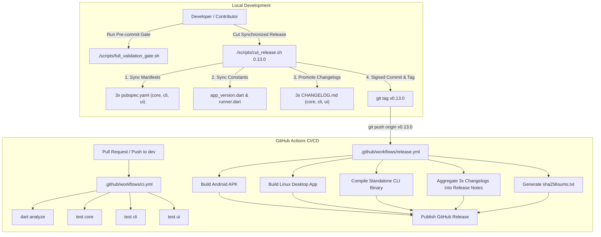

# Strategic Plan: Release & CI/CD Workflow Modernization

**Document ID:** `PLN-2026-REL-01`  
**Author:** Pooria Askari Moqaddam  
**Scope:** `sarvmd` monorepo (`packages/sarvmd_core`, `apps/sarvmd_cli`, `apps/sarvmd_ui`)  
**Status:** Ready for Review & Implementation  

---

## Executive Summary

Currently, `sarvmd` lacks automated continuous integration (CI) test gates on pull requests, while its production release process relies on an outdated, push-triggered Android workflow ([`.github/workflows/release_android.yml`](file:///home/ono/Projects/sarvmd/.github/workflows/release_android.yml)). This workflow only builds an Android APK, ignores Linux desktop and headless CLI binaries, and extracts changelog notes solely from `sarvmd_ui`.

This plan outlines a comprehensive, enterprise-grade release and CI/CD workflow architecture tailored to our **Synchronized Monorepo Architecture (Option A)**.

---

## Current Deficiencies vs. Target Architecture

| Area | Current State | Target State |
| :--- | :--- | :--- |
| **Release Trigger** | Triggers on every push to `master` (brittle, risks premature releases) | **Tag-driven**: Triggers strictly on `v*` tags (`v0.12.4`, `v0.13.0`) + manual dispatch |
| **Artifact Matrix** | Android APK only (`.apk`) | **Multi-artifact**: Android APK, Linux Desktop bundle, Standalone Linux CLI binary, SHA256 checksums |
| **Core Engine Handling** | Conflated with UI | Recognized as an internal zero-dependency engine (`publish_to: none`); statically compiled into apps |
| **Release Notes** | Slices only `apps/sarvmd_ui/CHANGELOG.md` | Aggregates notes from `sarvmd_ui`, `sarvmd_cli`, and `sarvmd_core` into a unified release body |
| **Pull Request CI** | None (only DCO sign-off check via `dco.yml`) | Fast parallel CI matrix (`analyze`, `test-core`, `test-cli`, `test-ui`) running on all PRs |
| **Local Validation Gate** | Broken script referencing defunct `sarvmd_composer` | Streamlined `./scripts/full_validation_gate.sh` validating all 3 packages |
| **Release Cutting** | Manual, error-prone edits across multiple files | Automated `./scripts/cut_release.sh <version>` enforcing checklist and DCO sign-off |

---

## Core Architecture Design



---

## Step-by-Step Implementation Breakdown

### Phase 1: Local Script Infrastructure Modernization

#### 1.1 Fix [`scripts/full_validation_gate.sh`](file:///home/ono/Projects/sarvmd/scripts/full_validation_gate.sh)
- **Objective**: Provide a fast, reliable 1-command verification gate for developers and CI.
- **Tasks**:
  1. Remove defunct steps 3/7 and 4/7 referencing `packages/sarvmd_composer`.
  2. Add `dart test` step for `apps/sarvmd_cli`.
  3. Ensure clean colored terminal outputs with exit code `0` on success and `1` on any failure.
- **Steps**:
  - `Step 1/4`: Static Analysis across workspace (`dart analyze`).
  - `Step 2/4`: Core Engine Unit Tests (`flutter test packages/sarvmd_core`).
  - `Step 3/4`: CLI Unit & Command Tests (`dart test apps/sarvmd_cli`).
  - `Step 4/4`: UI Unit & Widget Tests (`flutter test apps/sarvmd_ui`).

#### 1.2 Implement [`scripts/cut_release.sh`](file:///home/ono/Projects/sarvmd/scripts/cut_release.sh)
- **Objective**: Automate the [Release Versioning Procedure](file:///home/ono/Projects/sarvmd/.agents/AGENTS.md) to eliminate manual oversights.
- **Tasks**:
  1. Accept target version argument (e.g. `./scripts/cut_release.sh 0.13.0`).
  2. Validate SemVer format (`^[0-9]+\.[0-9]+\.[0-9]+$`).
  3. Verify git workspace has no unstaged/dirty changes.
  4. Automatically synchronize version string across:
     - `packages/sarvmd_core/pubspec.yaml`
     - `apps/sarvmd_cli/pubspec.yaml`
     - `apps/sarvmd_ui/pubspec.yaml`
     - `apps/sarvmd_ui/lib/src/core/constants/app_version.dart`
     - `apps/sarvmd_cli/lib/src/runner.dart`
  5. Check that each package's `CHANGELOG.md` has its version section promoted or automate promotion from `## [Unreleased]`.
  6. Execute `./scripts/full_validation_gate.sh`.
  7. Commit changes with DCO sign-off: `git commit -s -m "release: bump version to vX.Y.Z"`.
  8. Create annotated Git tag: `git tag -a vX.Y.Z -m "Release vX.Y.Z"`.

---

### Phase 2: Continuous Integration (`.github/workflows/ci.yml`)

- **Objective**: Validate every PR and branch push before merging.
- **Triggers**:
  ```yaml
  on:
    pull_request:
      branches: [master, dev]
    push:
      branches: [master, dev]
  ```
- **Jobs**:
  1. **`analyze`**: Checks out repository, installs Flutter/Dart SDK, and executes `dart analyze`.
  2. **`test-core`**: Runs `flutter test packages/sarvmd_core`.
  3. **`test-cli`**: Runs `dart test apps/sarvmd_cli`.
  4. **`test-ui`**: Runs `flutter test apps/sarvmd_ui`.
- **Concurrency**: Cancels stale in-progress runs on the same branch/PR (`concurrency: group: ${{ github.workflow }}-${{ github.ref }}, cancel-in-progress: true`).

---

### Phase 3: Unified Production Release (`.github/workflows/release.yml`)

- **Objective**: Replace the single-purpose `release_android.yml` with a multi-artifact release matrix triggered strictly by version tags.
- **Triggers**:
  ```yaml
  on:
    push:
      tags:
        - 'v*'
    workflow_dispatch:
      inputs:
        tag_name:
          description: 'Git tag to release (e.g. v0.13.0)'
          required: true
  ```

#### Release Matrix & Build Jobs:
1. **`build-android`**:
   - Environment: `ubuntu-latest`
   - Steps: Set up Java 17 + Flutter SDK, run `flutter build apk --release` in `apps/sarvmd_ui`.
   - Output: `sarvmd-v${VERSION}-android.apk`.
2. **`build-linux-desktop`**:
   - Environment: `ubuntu-latest` (with `libgtk-3-dev`, `ninja-build`, `pkg-config`).
   - Steps: Run `flutter build linux --release` in `apps/sarvmd_ui`.
   - Output: `sarvmd-ui-v${VERSION}-linux-x64.tar.gz`.
3. **`build-cli-linux`**:
   - Environment: `ubuntu-latest` (Dart SDK).
   - Steps: Run `dart compile exe bin/sarvmd.dart -o sarvmd` in `apps/sarvmd_cli`.
   - Output: `sarvmd-cli-v${VERSION}-linux-x64.tar.gz` (containing standalone executable `sarvmd` and `README.md`).
4. **`publish-release`**:
   - Depends on: `[build-android, build-linux-desktop, build-cli-linux]`.
   - **Multi-Package Release Notes Aggregator**:
     Extracts the corresponding `## [VERSION]` entry from each package:
     - `apps/sarvmd_ui/CHANGELOG.md` -> Section: `### 🖥️ Desktop & Web Studio (sarvmd_ui)`
     - `apps/sarvmd_cli/CHANGELOG.md` -> Section: `### ⚡ Headless CLI (sarvmd_cli)`
     - `packages/sarvmd_core/CHANGELOG.md` -> Section: `### 🎼 Engraving Engine (sarvmd_core)`
   - Computes `sha256sums.txt` for all compiled bundles.
   - Publishes GitHub Release using `softprops/action-gh-release@v2`.
5. **Deprecate**:
   - Delete or replace `.github/workflows/release_android.yml`.

---

## Verification & Rollout Plan

1. **Local Dry Run**:
   - Test `./scripts/full_validation_gate.sh` locally to verify 0 failures.
   - Test `./scripts/cut_release.sh` syntax and guard rails.
2. **Workflow Linter & Action Syntax Check**:
   - Validate YAML formatting and action dependencies (`actions/checkout@v4`, `subosito/flutter-action@v2`, `softprops/action-gh-release@v2`).
3. **Documentation Update**:
   - Document release commands in [`CONTRIBUTING.md`](file:///home/ono/Projects/sarvmd/CONTRIBUTING.md) and [`.agents/AGENTS.md`](file:///home/ono/Projects/sarvmd/.agents/AGENTS.md).
