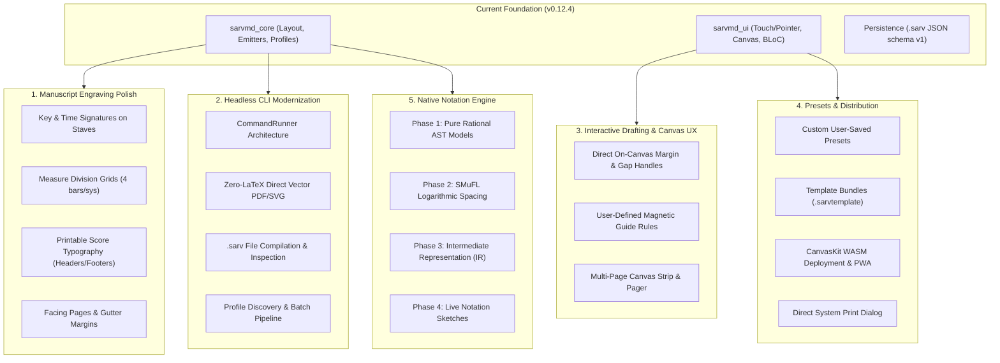

# SarvMD: Comprehensive Evolution & Improvement Roadmap

> [!NOTE]
> **SarvMD** stands in an advanced state of engineering maturity for its foundational "Blank Canvas" mission: 399 automated tests passing across packages, zero-dependency Dart core, multi-platform state persistence, MOLA/Gouldian bracket clusters, and 4-tier vector export parity (Interactive Canvas, SVG, PDF, and LaTeX). 
> This document charts the complete landscape of high-impact opportunities for improvement across the engine, UI, CLI, and notation roadmap.

---

## Architecture & Improvement Overview



---

## Detailed Improvement Landscape

### 1. Blank Manuscript Engraving & Composition Essentials
*(Rounding out the "Blank Canvas" into a publication-ready tool)*

| Feature | Current State | Target Enhancement | Impact |
| :--- | :--- | :--- | :--- |
| **Key & Time Signatures** | Clefs and line counts only | Pre-printed key signatures (Circle of Fifths accidentals) & time signatures ($4/4$, $3/4$, $6/8$, $\mathbf{C}$, $\boldsymbol{\phi}$) on 1st system or all systems | Essential for songwriting, student exercise sheets, and genre lead sheets |
| **Measure Division Grids** | Staves run continuous edge-to-edge | Configurable measure subdivisions (e.g. 2, 3, 4 bars per system) with light barlines, double barlines, or repeat signs | High demand for lead sheets, practice sheets, and structured sketchbooks |
| **Printable Score Typography** | Stored in [`DocumentMetadata`](file:///home/ono/Projects/sarvmd/packages/sarvmd_core/lib/src/domain/metadata.dart) but not drawn | Rendered Gouldian score headers (centered title, right-aligned composer, left subtitle/tempo, bottom copyright, running `- 2 -` page headers) | Eliminates external PDF editing; generates publication-ready sheet music |
| **Two-Sided Imposition (Facing Pages)** | Fixed symmetric margins | Alternating left/right margins (binding gutter vs. outer margin) for odd and even pages | Mandatory for spiral, coil, and saddle-stitched manuscript notebooks |
| **Staff Rendering Styles** | Solid lines only | Dotted or dashed lines for educational tracing; rhythm slashes for jazz lead sheets | Expands educational and commercial workbook utility |

---

### 2. Modernizing the Headless CLI (`sarvmd_cli`)
*(Immediate Kickoff Initiative)*

> [!IMPORTANT]
> The current [`apps/sarvmd_cli`](file:///home/ono/Projects/sarvmd/apps/sarvmd_cli) implementation is an early proof-of-concept relying exclusively on an external `pdflatex` shell command. It does not leverage `sarvmd_core`'s zero-dependency direct vector PDF and SVG emitters, nor can it process native `.sarv` documents.

#### Key Deficiencies & Upgrades:
1. **Direct Vector PDF & SVG Emitters**:
   - Utilize [`ScoreCompiler.compileToPdf`](file:///home/ono/Projects/sarvmd/packages/sarvmd_core/lib/src/compiler/score_compiler.dart) and [`ScoreCompiler.compileToSvg`](file:///home/ono/Projects/sarvmd/packages/sarvmd_core/lib/src/compiler/score_compiler.dart).
   - Generates vector-perfect PDFs and SVGs instantly on any machine without requiring TeX Live or `pdflatex`.
2. **Native `.sarv` File Compilation**:
   - Implement `sarvmd compile <file.sarv> -o <output> --format <pdf|svg|tex>`.
   - Allows composers, publishers, and automated CI pipelines to compile manuscript files headlessly.
3. **Structured `CommandRunner` Architecture**:
   - Refactor `bin/sarvmd.dart` into a modular `package:args/command_runner.dart` structure following the `dart-build-cli-app` guidelines.
   - Subcommands (strictly canonical long form + single-character short form):
     - `generate` (short: `g`): Generate blank manuscript paper from profiles or parameters.
     - `compile` (short: `c`): Compile an existing `.sarv` file to PDF/SVG/LaTeX.
     - `inspect` (short: `i`): Display metadata, system count, staff count, and page configuration of a `.sarv` file.
     - `profiles` (short: `p`): List all available built-in staff profiles ([`StaffProfiles.all`](file:///home/ono/Projects/sarvmd/packages/sarvmd_core/lib/src/profiles.dart)) with IDs, categories, and metrics.
   - **Strict Non-Redundancy Policy**: Eliminates arbitrary synonym aliases (e.g. `new`, `create`, `build`, `info`, `presets`, `list-profiles`) and multi-character contractions (`gen`, `cmp`, `ins`, `prof`). The only valid alias is strictly the familiar and convenient single-character abbreviation (`g`, `c`, `i`, `p`).
4. **Comprehensive Automated Tests**:
   - Add unit and integration tests verifying command routing, exit codes, help output, and file generation.

---

### 3. Interactive Canvas & CAD-Style Direct Manipulation
*(Elevating the editing experience to professional drafting precision)*

* **On-Canvas Interactive Margin & Gap Drag Handles**:
  - Instead of relying solely on sidebar sliders, provide hover/drag handles directly on the canvas page margin guides and inter-system spacing lines.
  - Live millimeter HUD bubbles update in real-time during dragging with snap-to-grid capabilities.
* **User-Defined Alignment Guides**:
  - Allow users to pull horizontal and vertical magnetic guide rules from the canvas rulers (similar to Figma or Illustrator).
* **Multi-Page Canvas Strip / Carousel**:
  - Currently, [`PreviewCanvas`](file:///home/ono/Projects/sarvmd/apps/sarvmd_ui/lib/src/presentation/widgets/canvas/preview_canvas.dart) renders page 1.
  - Adding a page navigator or vertical continuous page strip allows visual verification of multi-page scores, first-system indents, and subsequent-system header lifecycle rules (`GroupHeaderVisibility`).

---

### 4. Presets, Templates & Sharing Ecosystem

* **Custom User Presets**:
  - Allow users to save any active custom ensemble layout into a personal library in `SharedPreferences` or local filesystem.
  - User presets appear seamlessly alongside standard profiles in [`ProfilePicker`](file:///home/ono/Projects/sarvmd/apps/sarvmd_ui/lib/src/presentation/widgets/staff/profile_picker.dart).
* **Template Export & Import (`.sarvtemplate`)**:
  - Enable sharing pre-configured scoring templates among music educators, composition studios, and publishers.
* **Expanded Specialized Profiles**:
  - Renaissance Polyphony (mensural clefs and open systems).
  - Modern Drum Kit / Marching Battery (multi-line percussion with specialized clefs).
  - Contemporary Big Band & Jazz lead sheets.

---

### 5. Web, Cloud & Mobile Distribution

* **WASM / CanvasKit CI/CD Web Pipeline**:
  - Configure GitHub Actions to automatically compile and deploy `sarvmd_ui` as a high-performance Flutter Web CanvasKit/WASM application.
* **Progressive Web App (PWA) Capabilities**:
  - Offline Service Worker caching, installable web app manifest, and File Handling API registration for direct `.sarv` file opening in desktop browsers.
* **1-Tap Direct System Print**:
  - Add native print action delegating directly to OS print services or browser `window.print()`, eliminating the need to save and manually open PDFs in an external viewer.
* **Mobile Haptics & Stylus Support**:
  - Fine tactile haptic feedback when sliders snap to standard Rastral sizes or when tabs switch.
  - Palm-rejection and Apple Pencil / active stylus support on tablets.

---

### 6. The Long-Term Horizon: Native Notation Engraving Engine

> [!TIP]
> The architectural roadmap in [notation_and_engraving_pipeline.md](file:///home/ono/Projects/sarvmd/.agents/research/notation_and_engraving_pipeline.md) establishes the complete mathematical specification for expanding SarvMD from a blank manuscript designer into a full engraving engine:

```text
[ Score AST ] ──> [ Rational Durations & Pitch ] ──> [ SMuFL Spindles & Spacing ] ──> [ Visual IR Emitters ]
```

1. **Phase 1: Pure Logical AST Domain Models**:
   - Exact rational duration arithmetic ($\text{gcd}(a,b)$) with zero floating-point drift.
   - Scientific Pitch Notation with diatonic spelling preservation (`Pitch`, `NoteName`, `Accidental`).
   - Sealed `MusicalEvent` hierarchy: `NoteEvent`, `RestEvent`, `ChordEvent`, `Voice`, `Measure`, `Part`, `Score`.
2. **Phase 2: SMuFL Symbol Registries & Horizontal Spacing Spindles**:
   - Staff-space units ($sp$) and Gouldian non-linear logarithmic spacing algorithms ($d = w \cdot \text{duration}^{0.6}$).
3. **Phase 3: Visual Intermediate Representation (IR) & Stateless Emitters**:
   - Sealed `PositionedElements` with absolute physical coordinates and universal horizontal justification.
4. **Phase 4: Live Interactive Notation & Lead Sheets**:
   - Direct note input, chord symbol placement, and rehearsal marks directly on the SarvMD canvas.

---

## Action Plan: CLI Modernization (`sarvmd_cli`)

To initiate this roadmap, modernizing the headless CLI is the optimal first step. It is self-contained, directly exercises `sarvmd_core`, and delivers immediate automation utility for power users.

### Target CLI Command Structure

```bash
# Generate manuscript using a built-in profile (direct vector PDF, no LaTeX needed)
sarvmd generate --profile piano --size a4 --orientation portrait -o output/piano.pdf

# Generate manuscript with custom format (SVG or LaTeX)
sarvmd generate --profile stringQuartet --format svg -o output/quartet.svg
sarvmd generate --profile leadSheet --format tex -o output/lead.tex

# Compile a native .sarv project file (short form: cmp)
sarvmd compile score.sarv -o score.pdf
sarvmd compile score.sarv --format svg -o score.svg

# Inspect a .sarv file (short form: ins)
sarvmd inspect score.sarv

# List all available built-in profiles (short form: prof)
sarvmd profiles
```
